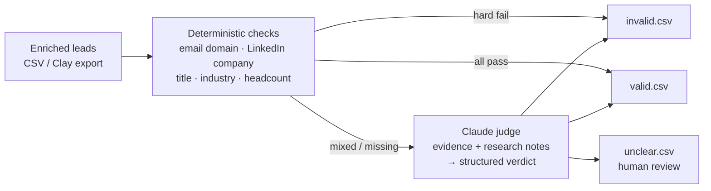

# lead-qualification-pipeline

**Only qualified leads get into a campaign. Every enriched lead is checked against its email domain, current LinkedIn company, title and ICP. Clear cases are settled by rules, and Claude only judges the ones that are actually ambiguous. Each lead ends up as `valid`, `invalid` or `unclear`, with a reason attached.**

Bad leads cost twice: once in enrichment credits, again in bounced emails and burned domains. This is the gate I put between enrichment and sequencing.

▶ [Walkthrough of the Clay version (Loom)](https://www.loom.com/share/938105ad97a34321aeef615bbad1527f)



## Why rules first, LLM second

| | Rules | Claude |
|---|---|---|
| **Good at** | Exact facts: does `@acme.com` match `acme.com`? Is "Intern" an excluded title? | Judgement: "Tailspin rebranded from Tailspin Toys", "Growth Lead" at a 200-person company |
| **Cost** | Free, instant | Paid per call |
| **Explainable** | Each check says why it passed or failed | Returns a one-sentence reason that cites the evidence |

In the sample batch, 5 of 7 leads are decided by rules and **only 2 go to the model**. At list scale that's the difference between paying to classify every row and paying only for the hard ones.

## The checks

| Check | Hard? | Fails when |
|---|---|---|
| `email_domain` | ✅ | email is `@other.com` but company is `acme.com` (personal inboxes → unknown, not fail) |
| `linkedin_company` | ✅ | LinkedIn current company doesn't match: the person has left (fuzzy match, suffix-insensitive) |
| `excluded_title` | ✅ | title contains an excluded keyword (intern, assistant…) |
| `excluded_industry` | ✅ | industry is on the exclude list |
| `target_title` | | title isn't on the buyer list → unknown, sent to Claude |
| `employee_band` | | headcount outside the ICP band |

A hard fail means `invalid`, with no API call. All checks passing means `valid`. Anything else goes to the judge.

## The judge

[`judge.py`](leadqual/judge.py) sends the ICP, the lead, every check result and any research notes to Claude, and gets back a **schema-validated** verdict via structured outputs:

```python
class Judgement(BaseModel):
    verdict: Literal["valid", "invalid", "unclear"]
    confidence: Literal["high", "medium", "low"]
    reason: str
```

- Runs at low effort: this is classification, not research.
- Server-side fallbacks are on, so a declined request is retried on another model instead of failing the batch. A request that's still declined becomes `unclear`, never a guess.
- The model is told to use only the evidence given. When the evidence is thin, the right answer is `unclear` and a human looks at it.

## Run it

```bash
pip install -e ".[dev]"

# rules only, no API key needed
python -m leadqual.pipeline --input examples/leads.csv --out out --dry-run
# 7 leads -> valid: 2, invalid: 3, unclear: 2 (0 sent to Claude)

# full run
export ANTHROPIC_API_KEY=...
python -m leadqual.pipeline --input examples/leads.csv --out out
```

Input columns: `first_name, last_name, title, company, domain, email, linkedin_company, linkedin_title, industry, employee_count, research_notes`, which is what a Clay table exports after enrichment. Output: `out/valid.csv`, `out/invalid.csv`, `out/unclear.csv`, each row with `verdict`, `decided_by` (rules or Claude + confidence), `reason`, and the per-check results.

ICP lives in [`config/icp.json`](config/icp.json).

## Tests

```bash
pytest -q
# 8 passed
```

Covers the normalizers, each verdict path on the sample leads, that **only** unclear leads reach the judge, and the CLI end to end.

## Layout

```text
leadqual/
  checks.py     deterministic checks + rule verdict
  judge.py      Claude structured-output judge
  pipeline.py   CLI, routing, CSV outputs
config/icp.json
examples/leads.csv
tests/
```

## License

MIT
